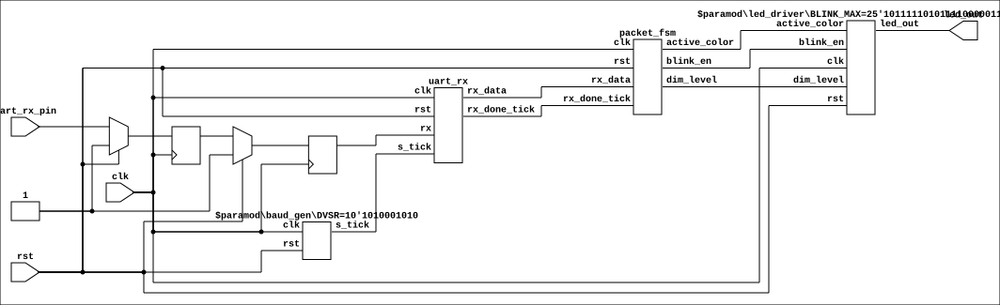

# Offline Voice-Controlled FPGA LED System (Verilog RTL)

A complete, synthesizable Verilog-2001 RTL implementation of an offline voice-controlled RGB LED modulation system targeting the **Xilinx Artix-7 FPGA (Digilent Basys 3 / XC7A35T)** and the **Elechouse Voice Recognition Module V3** at a **100 MHz** system clock.

---

## Repository Structure

```text
├── ElechouseV3Module_Training/ # Serial interface scripts for V3 offline voice training
├── constraints/                # Xilinx Artix-7 (Basys 3) physical pin mappings (.xdc)
├── docs/                       # Hardware reference manuals, SVG schematics, and waveforms
├── rtl/                        # Synthesizable Verilog-2001 hardware modules
│   ├── top_voice_led.v         # Top-level motherboard wrapper & 2-FF CDC synchronizer
│   ├── baud_gen.v              # Modulo-651 16x oversampling baud tick generator
│   ├── uart_rx.v               # 8N1 UART receiver FSM
│   ├── packet_fsm.v            # 9-byte Elechouse V3 protocol parser & command latch
│   └── led_driver.v            # 2 Hz blink & 390.6 kHz 4-level LUT6 PWM engine
├── tb/                         # Verification testbenches
│   └── tb_top_voice_led.v      # Self-checking testbench covering all 11 test cases
├── .gitignore                  # Ignores large waveform dumps (.vcd, .fst) and Vivado logs
├── Makefile                    # One-command simulation & RTL SVG diagram generation
└── README.md                   # Project overview and architecture documentation
```

## System Architecture & Data Flow

1. **Acoustic Capture (Elechouse V3):** Recognizes 7 trained spoken commands offline and transmits deterministic 9-byte hexadecimal frames (`AA 07 0D 00 FF [R] [RI] 00 0A`) over 9600-baud 8N1 UART.
2. **Voltage Level Shifting (BSS138 MOSFET):** Steps 5.0V TTL serial logic down to 3.3V LVCMOS to protect Artix-7 I/O banks.
3. **2-FF CDC Synchronizer (`top_voice_led.v`):** Double-registers the asynchronous serial input into the 100 MHz clock domain, initializing to idle HIGH (`1'b1`) to prevent false start-bit triggers on reset release.
4. **16x Oversampled UART Receiver (`baud_gen.v` & `uart_rx.v`):** Divides the 100 MHz clock by 651 (`153.6 kHz` `s_tick`) and samples incoming serial bits at the exact midpoint (`tick 7` for Start Bit, `tick 15` for Data/Stop Bits).
5. **9-Byte Protocol Firewall (`packet_fsm.v`):** Validates header/control fields byte-by-byte, eliminates premature `0x0A` payload collisions, buffers `temp_rec_id` until frame-end verification, and supports mid-packet `0xAA` resynchronization.
6. **Hardware Blink & LUT6 PWM Engine (`led_driver.v`):** Combines a 2 Hz hardware blink timer (`25,000,000` cycles) with a 390.625 kHz 4-stage zero-comparator PWM dimmer synthesized into a single 6-input LUT using De Morgan's Law.

### Top-Level RTL Schematic


---

## Spoken Command Decoding Table

| Record ID | Spoken Command | `active_color[2:0]` | `blink_en` | `dim_level[1:0]` |
| :---: | :---: | :---: | :---: | :---: |
| `8'h00` | **"Red"** | `3'b100` (Red ON) | Unchanged | Unchanged |
| `8'h01` | **"White"** | `3'b010` (Green ON) | Unchanged | Unchanged |
| `8'h02` | **"Blue"** | `3'b001` (Blue ON) | Unchanged | Unchanged |
| `8'h03` | **"All"** | `3'b111` (All 3 ON) | Unchanged | Unchanged |
| `8'h04` | **"Blink"** | Unchanged | `~blink_en` (Toggles 2 Hz) | Unchanged |
| `8'h05` | **"Low"** | Unchanged | Unchanged | `dim_level + 1` (100% / 50% / 25% / 12.5%) |
| `8'h06` | **"Clear"** | `3'b000` (All OFF) | `1'b0` (Steady) | `2'b00` (100%) |

---

## Simulation & Verification (`iverilog` + `GTKWave`)

The self-checking testbench (`tb/tb_top_voice_led.v`) transmits true 9600-baud 8N1 serial frames and verifies **15 automated assertions** covering all 7 voice commands, all 4 PWM duty cycles (`256/256`, `128/256`, `64/256`, `32/256`), and 3 protocol hazard injection tests (corrupted frame end `0xFF`, `0x0A` payload data collision, and mid-packet cut-off `0xAA` resynchronization).


### Quickstart Commands

    # 1. Run self-checking simulation
    make sim

    # 2. Open waveforms in GTKWave
    make wave

    # 3. Regenerate Yosys + netlistsvg RTL schematics
    make rtl

### Subsystem Gate-Level Schematics
- 9-Byte Packet Parser FSM: `docs/schematics/rtl_packet_fsm.svg`
- LED Blink & 4-Level PWM Driver: `docs/schematics/rtl_led_driver.svg`
- 16x Oversampled UART Receiver: `docs/schematics/rtl_uart_rx.svg`
- Modulo-651 Baud Rate Generator: `docs/schematics/rtl_baud_gen.svg`
